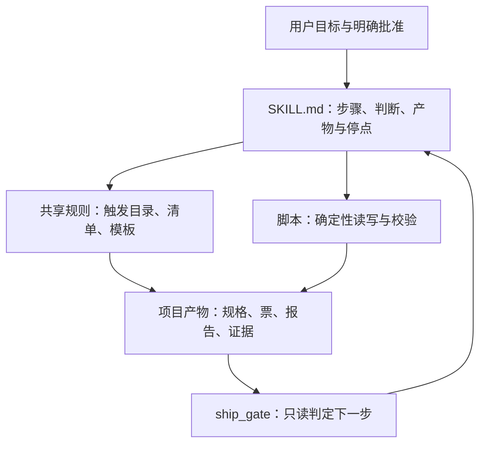
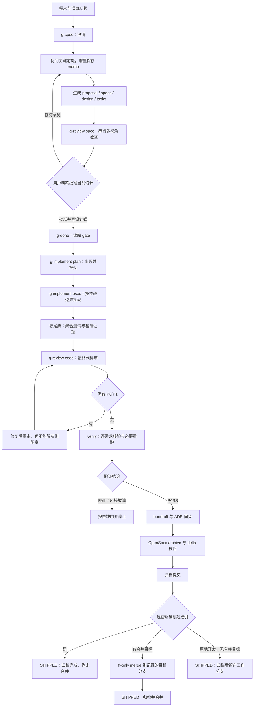

# G Skills

[项目网站与完整使用手册](https://g-skills.pages.dev/)

一套围绕 OpenSpec 的规格驱动开发 skills：把需求讨论、方案生成、设计评审、逐票实现、代码评审、测试验证和归档合并串成可恢复的开发流程。

项目面向使用 Claude Code、Codex 等支持本地 skills 的开发者。本仓库既包含给 AI 阅读的 `SKILL.md`，也包含负责文件操作、状态判定和格式校验的 Python / Shell 脚本，以及共享规则、模板和测试。

**当前执行方式是单人、单会话、串行推进。** 需求生成、不同视角的评审和实现都由当前主会话执行；不派发子代理，不做跨模型调用，不配置模型档位或 effort 调度。阶段交界可以清理上下文，但这不等于获得了独立审查者。

日常使用最常见的四个入口是：

```text
/g-init                 给目标项目接入工作流
/g-spec                 把一次需求做成经过讨论的变更规格
/g-review spec          评审设计，交给用户明确批准
/g-done <change>        按盘面继续实现、评审、验证、归档和合并
```

`g-done` 会使用 `g-implement` 和 `g-review code`，通常不需要用户逐个手动调用。

---

## 目录

1. [这套项目解决什么问题](#purpose)
2. [第一次使用：从安装到完成一个变更](#quick-start)
3. [先理解几个概念](#concepts)
4. [安装位置、依赖和运行方式](#installation)
5. [所有 skill 的职责与选择](#skills)
6. [主流程如何工作](#main-flow)
7. [项目级规划与环境 skills](#planning)
8. [issues、ADR 与复盘](#records)
9. [项目会生成哪些文件](#artifacts)
10. [gate 状态机与内容指纹](#gate)
11. [测试配置、证据和 PASS 的边界](#verification)
12. [Git、提交和合并行为](#git)
13. [中断以后怎样恢复](#resume)
14. [脚本诊断与高级用法](#commands)
15. [升级和规则维护](#upgrade)
16. [常见问题](#faq)
17. [开发本项目与验证改动](#development)
18. [能力边界与文档导航](#limits)

<a id="purpose"></a>

## 1. 这套项目解决什么问题

AI 辅助开发的困难经常发生在步骤之间：需求只存在于对话中，设计没有明确批准，任务勾完却没有真实验收，评审后的修复没有重新测试，或者会话中断后不知道从哪里继续。

gear 把这些衔接点变成文件和判据：

| 常见问题 | 本项目的处理方式 |
|---|---|
| 讨论很长，换会话就丢决策 | `decision-memo.md` 持续记录承重约束、拍板决策与证据 |
| 一上来生成一堆文档，关键前提没想清 | `g-spec` 先澄清和拷问，再生成正式产物 |
| 设计评审通过与用户同意混在一起 | 设计报告交人批准，明确批准后才写设计门锚 |
| 实现拆成横向大任务，很晚才能验证 | `tickets.md` 采用可独立验证的纵向切片，并写出依赖 |
| AI 只凭复选框认为做完了 | gate 以已提交的 checkpoint 完成标签识别进度 |
| 代码改了，旧评审还被认为有效 | 评审、验证报告绑定代码内容指纹，变化后重跑 |
| 报告提交顺手夹带未验证代码 | 代码报告限定提交路径，PASS 写入核对检查前的提交基准 |
| 测试没配，直接被当作不需要测试 | 返回待发现的测试层，要求查项目实际命令或说明未覆盖依据 |
| 历史问题反复建号，来源被覆盖 | issues 保留原始来源，评审台账区分 `new` 与 `reuse` |
| 归档只是搬目录，主规格没同步 | 收尾调用 OpenSpec archive，并核验 delta 同步结果 |
| 中断后靠聊天记忆重做 | `g-done` 重新运行只读 gate，从当前文件和 Git 记录续跑 |

这些机制能提高执行的可追溯性，但不会自动证明需求理解正确、测试充分或评审判断无误。脚本负责可确定的部分，语义判断仍由执行者完成，关键设计由用户拍板。

<a id="quick-start"></a>

## 2. 第一次使用：从安装到完成一个变更

### 2.1 安装本机工具链

在终端运行：

```bash
cd /path/to/gearbox
bash setup.sh
```

安装脚本会检查依赖并输出 `installed`、`unchanged`、`skipped` 等清单。**出现 ready 不代表所有依赖与安装项都成功；需要看清缺失提示和 skipped 的原因。**

这里的路径替换成你的实际 checkout。若以后发布自己的远程仓库，可将它 clone 到标准运行位置 `~/.skills/g-skills`；本文不假设一个尚未提供的 G Skills 仓库 URL。已有 checkout 按[升级说明](#upgrade)更新。

### 2.2 在目标项目中初始化

切到你实际开发的项目，而不是本工具仓：

```bash
cd /path/to/your-project
git status --short
openspec --version
```

如果尚未初始化 OpenSpec，先在该项目运行：

```bash
openspec init
```

然后在 AI 会话里调用：

```text
/g-init
```

初始化后，需要让执行者根据真实项目补充 `openspec/config.yaml` 的技术栈、边界与约定。已有配置时保留项目内容，合并通用 context 和 rules；不要用模板整份覆盖原配置。

### 2.3 给出一项真实需求

例如，在 AI 会话中说：

```text
使用 g-spec，为现有订单列表增加按订单状态筛选的能力。
保持现有分页和权限行为，先核对项目代码与测试约定，再讨论边界。
```

支持斜杠入口的宿主也可以写：

```text
/g-spec
为现有订单列表增加按订单状态筛选的能力。
```

AI 会先确认目标、调查现状、验证关键前提，再创建 change 和生成文档。假设本次 change 名为 `filter-orders-by-status`，后续目录就是：

```text
openspec/changes/filter-orders-by-status/
```

这里的名称只是示例。实际运行时使用本次生成的准确名称，不要照抄不存在的 change。

### 2.4 设计评审与明确批准

生成完成后，按出口指引清理上下文，再运行设计审：

```text
/clear
/g-review spec
请评审 filter-orders-by-status。
```

`/clear` 是会话操作，不是 shell 命令。宿主没有对应入口时，可以开启新会话并指向同一项目、同一 change；新的会话需要重新读取产物。

阅读 `spec-review-report.md`，确认范围、关键决策、代价与尚未解决的问题。批准时给出明确指示，例如：

```text
批准 filter-orders-by-status 的当前设计，按报告中的方案执行。
```

执行者随后写入设计门锚。**报告写着“通过”、文件已经生成、用户没有反对，都不能代替明确批准。**

### 2.5 交给 done 连续推进

设计门落盘后，可以再次清理上下文，再调用：

```text
/clear
/g-done filter-orders-by-status
```

正常情况下，它会连续推进：

```text
出票 → 逐票实现和自审 → 聚合测试 → 最终代码审 → verify
→ hand-off → ADR 同步 → archive → 同步核验 → commit → ff-only merge
```

它会自动创建流程提交，**不会自动 push**。遇到真实阻塞会停止并报告原因，不会为了到达完成状态而改写失败结论。

### 2.6 只归档，暂时不合并

在调用里明确表达：

```text
/g-done filter-orders-by-status
完成验证和归档，先不要合并。
```

流程使用 `.skip-merge` 标记保存这个意图。归档与有效验证结论满足条件后，可以正常结束；完成摘要会注明尚未合并。

之后改变主意，可以重新调用：

```text
/g-done filter-orders-by-status
现在把这个已归档的变更合回记录的起始分支。
```

执行者会读取归档中的分支约定，在未请求合并（merge_target=null）时先确认具体目标；有目标时在归档位置删除并单独提交 `.skip-merge`，重新运行 gate 后继续合并。仅在工作树删掉标记还不足以恢复流程，因为 gate 读取的是已提交状态。

### 2.7 什么时候算完成

完成后查看：

- 归档目录中的 `verify-report.md`：需求逐条核验、证据、缺口与结论。
- `hand-off.md`：详细变更说明，包含完成能力、关键文件、修改前后行为、实现取舍、提交/证据、测试结果、覆盖边界，以及未完成事项与后续建议。
- `openspec/specs/`：本次行为变化同步后的正式规格。
- Git 记录：流程提交，以及合并结果或明确的 skip-merge 状态。

**`SHIPPED` 在本项目中表示开发流程的归档/合并终态，不表示应用已经部署上线。**

<a id="concepts"></a>

## 3. 先理解几个概念

### 3.1 三种位置不要混用

| 位置 | 放什么 | 常见例子 |
|---|---|---|
| 工具链 checkout | 本仓源码、skills、模板、测试、安装器 | `~/.skills/g-skills/` |
| 全局安装位置 | 宿主发现的 skills、共享规则入口、辅助脚本 | `~/.agents/skills/`、`~/.claude/skills/`、`~/.g/` |
| 消费项目 | 你真正开发的软件、项目配置、变更与报告 | `/path/to/your-project/openspec/` |

脚本位于工具链或已安装的 skill 目录中；脚本的 `--root` 通常指向**消费项目根目录**。把两者弄反，会让脚本检查或修改错误的仓库。

### 3.2 术语速查

| 术语 | 在本项目中的含义 |
|---|---|
| skill | 给 AI 的任务入口，核心是 `SKILL.md`，按需使用 scripts / references / assets |
| change | 一次可交付的变更，活动材料在 `openspec/changes/<change>/` |
| 四件套 | `proposal.md`、`specs/`、`design.md`、`tasks.md`；`specs/` 可以包含多份文件 |
| delta spec | 当前 change 对行为规格的新增、修改、移除或重命名 |
| 主 spec | `openspec/specs/` 中当前有效的行为契约 |
| decision memo | 拷问后留下的约束、决策、证据和被否方案，承担跨会话传递职责 |
| ticket | 实现管线中的独立验证单元，记录在 `tickets.md`，不是 issues 台账里的 B/T 项 |
| checkpoint | 用固定 Conventional Commits 格式记录一个流程节点的提交 |
| gate | `ship_gate.py` 读取文件和 Git 状态后给出的下一步判定 |
| anchor / 锚 | 报告头部 `ship-gate` 中的结论与内容指纹 |
| canonical 规则 | 全局共享、运行时实际读取的规则源，不是消费仓的人读手册副本 |
| lens / 镜 | 一次检查的视角，例如范围、工程可行性、领域、对抗、接地 |
| hand-off | 交接记录，说明剩余事项、覆盖边界和必要的后续动作 |
| SAD | 项目级系统架构文档，位于 `openspec/architecture/sad.md` |
| ADR | 有背景、备选、取舍和后果的架构决策记录，位于 `openspec/adr/` |

### 3.3 三层职责



- **用户**决定目标、偏好与关键方案批准。
- **AI**调查、讨论、写文档、实现、读码、评审和执行验证。
- **脚本**处理可确定的结构与操作，例如编号、依赖、指纹、索引、状态与原子写入。

没有一个脚本能代替另外两层完成所有工作。格式 lint 通过不等于内容正确；gate 可推进不等于所有语义风险都已消除。

<a id="installation"></a>

## 4. 安装位置、依赖和运行方式

### 4.1 依赖分层

以下版本信息来自仓库中的安装检查与 CI 配置，用于说明本项目的要求与复现环境。

| 依赖 | 用途 | 要求或本仓验证方式 |
|---|---|---|
| Git | 分支、内容树、checkpoint、恢复与合并 | 必需，需能正常访问消费项目的 Git 记录 |
| Bash | 安装器与辅助脚本 | macOS / Linux 使用 Bash；Windows 使用 Git Bash |
| Python 3 | 本地 helpers、recorder、lint | 安装器探测下限为 3.7；本仓 CI 的 Python 档为 3.9 / 3.12 / 3.14 |
| mikefarah/yq | 通用 YAML 与 frontmatter 的读取和校验 | 至少 4.16.0；本仓 CI 固定 4.53.6 |
| OpenSpec CLI | 创建 change、读取上下文与 instructions、validate、archive | 主流程必需；本仓 CLI 契约测试固定 1.14.3 |
| Node.js / npm | 运行 OpenSpec CLI，开发时安装 DOM 测试依赖 | 复现 CLI 测试可使用 CI 的 Node 22；CLI 1.14.3 的 Node 下限为 20.19.0 |
| pytest | 开发本工具仓、运行回归测试 | `pytest>=8`；使用 skills 本身不要求安装 pytest |
| Chromium / Playwright | 本工具仓的评审页浏览器回归 | 仅相关开发测试需要，不是日常工作流的运行依赖 |

多数 Python helper 使用标准库。通用 YAML 场景依赖外部 `yq`；issues 的单文件台账使用自己的有界字段格式，不需要额外安装 PyYAML。

**注意区分同名 yq。** 这里需要 mikefarah/yq，不是 Python 包 kislyuk/yq。可先检查：

```bash
git --version
python3 --version
yq --version
openspec --version
```

复现本仓固定 CLI 版本的安装命令：

```bash
npm install -g @fission-ai/openspec@1.14.3
```

安装器会提供各平台的缺依赖指引，不会自动把所有系统依赖装齐。消费项目需要的数据库、容器、硬件 SDK、测试服务等由项目自身决定。

### 4.2 setup.sh 安装到哪里

| 落点 | 用途 | 更新方式 |
|---|---|---|
| `~/.claude/skills/<skill>/` | Claude 一侧的 skill 发现目录 | Unix 为源码绝对路径软链，Windows 为受管理复制 |
| `~/.agents/skills/<skill>/` | 共享 Agent Skills 目录，供支持它的宿主发现 | 同上 |
| `~/.g/workflow` | Unix 上共享规则目录的软链 | 指向当前工具链 checkout 的权威规则源 |
| `~/.g/workflow-path` | Windows 上共享规则源的路径指针 | 由 resolver 读取 |
| `~/.g/hack/` | checkpoint、规则解析、页面生成等辅助工具 | 复制安装，修改源文件后必须重跑 setup |
| `~/.claude/agents/` | 兼容安装器保留的三个历史角色定义 | 由安装器维护自属定义；当前主流程不派发这些角色 |

安装器通过根目录下的 `SKILL.md` 识别 skill，`docs/`、`hack/` 等不会被误装成 skill。已有的非本工具同名实体目录会被跳过并报告，不会无条件覆盖。

新共享位置安装成功后，安装器会清理旧 `~/.codex/skills/` 中可确认属于本工具的对应安装项，保留其它 skills。

**不要在安装后删除或随意移动工具链 checkout。** Unix skill 软链与全局规则源需要它持续存在。

### 4.3 项目初始化与全局安装的区别

`bash setup.sh` 让本机找到 skills 和共享工具；`/g-init` 让**一个目标项目**接上工作流。二者不能互相替代。

`g-init` 的确定性入口是：

```bash
# 在消费项目根目录执行；安装路径按实际宿主选择
python3 "$HOME/.agents/skills/g-init/scripts/init.py" init --root .
```

初始化主要处理：

1. `openspec/changes/`、`openspec/specs/` 等核心目录。
2. 人读手册 `openspec/workflow/WORKFLOW-GUIDE.md`。
3. CLI 版本门允许时，铺设 `openspec/schemas/g-spec-driven/`。
4. 新建配置或窄改配置的 `schema` 键，并提示人工/AI 合并项目内容。
5. 注入 `CLAUDE.md`、`AGENTS.md`、`openspec/INDEX.md` 的托管区块。
6. 合并托管的运行时忽略项，检查旧规则残留。
7. 幂等安装 Claude 全局 hooks，并清理可识别的退役 hook / 部署文件。

其中 hook 包括分支守卫，以及兼容保留的 `g-*` 子代理权限请求守卫；**后者存在不表示当前流程会启动子代理**。这些是 Claude hook 机制，不应声称在所有宿主上都有相同的工具拦截效果。

托管标记之外的项目内容会保留。想修改托管内容，应修改工具源中的 snippets，再更新项目，不要直接改标记内部。

### 4.4 project-local schema 与版本门

`g-init` 检查 OpenSpec CLI 版本：

- CLI 可解析且至少 1.7.0：允许铺设 project-local 的 `g-spec-driven` schema。
- CLI 不可用、版本不可解析或过低：不铺该 schema，按脚本的降级路径保持内置 `spec-driven`。
- 切换项目前，先为符合迁移条件的在途 change 补写其原 schema 标记，避免全局配置切换改变在途解释。

这个 schema 描述四件套的结构与依赖，也为不改变行为的变更提供 `skip_specs` 语义。schema 中历史名为 delegation 的提示块现在负责引导回 `/g-spec` 入口，不提供多代理调度。

`context` 和 `rules` 是给执行者的生成指导。**不要把它们当作 OpenSpec validate 已经执行过的硬校验。**

### 4.5 在不同宿主里如何调用

本 README 使用 `/g-xxx` 展示会话入口。实际触发形式取决于宿主，可以通过斜杠菜单、宿主提供的 skill 选择方式，或明确要求“使用 g-xxx”来调用。

如果宿主没有显示 skill：先确认安装目录与文件，再检查宿主的发现方式或重新打开会话。不要把缺少某种调用接口描述为“模型拒绝调用”。

文中的 `python3 ...`、`bash ...`、`git ...` 是终端命令；`/g-xxx`、`/clear` 是对话操作。Windows 默认终端为 PowerShell 时，工作流里的 Bash 命令需经 Git Bash 执行；`python3` 不可用时选择实际可用的 Python 3 解释器。

<a id="skills"></a>

## 5. 所有 skill 的职责与选择

仓库目前有 12 个 skill 目录。`g-review` 的两种评审模式、`g-implement` 的两种实现模式共用各自的入口，不是额外安装项。

| Skill | 什么时候使用 | 主要输入 | 主要产物 / 行为 |
|---|---|---|---|
| [g-init](./g-init/SKILL.md) | 首次给项目接入工作流，或刷新项目托管材料 | 目标项目、已有配置 | 目录、配置、schema、手册、入口托管区块 |
| [g-upgrade](./g-upgrade/SKILL.md) | 升级本机 gear 工具链 | 标准运行 checkout | `pull --ff-only` → setup → 展示版本 |
| [g-spec](./g-spec/SKILL.md) | 开始一次明确交付边界的变更 | 需求、现状、项目约束 | 四件套、`decision-memo.md` |
| [g-review](./g-review/SKILL.md) | 设计审或实现后的代码审 | `spec` / `code` 模式与 change | 评审报告、发现处置、对应 gate 锚 |
| [g-implement](./g-implement/SKILL.md) | 设计已批准后出票、逐票实现 | `mode=plan` / `mode=exec` | `tickets.md`、实现报告、代码与完成标签 |
| [g-done](./g-done/SKILL.md) | 从当前盘面推进到开发流程完成 | change、可选合并意图 | 驱动实现、评审、verify、交接、归档与合并 |
| [g-architecture](./g-architecture/SKILL.md) | 项目级子系统边界、contract、骨架设计 | 系统目标、外部系统、硬约束 | SAD、架构日志、骨架切片建议 |
| [g-roadmap](./g-roadmap/SKILL.md) | 工作超过一个 change，需分阶段规划 | 目标、约束、已有架构 | design / roadmap / task-log，可选 memo |
| [g-devenv](./g-devenv/SKILL.md) | 梳理测试策略、开发环境与测试执行路径 | 真实代码、现有工具、可选 SAD | 环境文档、测试策略、泳道状态、脚手架 |
| [g-issues](./g-issues/SKILL.md) | 记录缺陷、优化、技术债，跟踪处理状态 | 描述、模块、来源与证据 | B/T 单文件台账与生成索引 |
| [g-adr](./g-adr/SKILL.md) | 新建决策、变更后同步决策、存量体检 | 决策背景、代码、change | ADR 文件、格式检查、偏离项记录 |
| [g-retro](./g-retro/SKILL.md) | 查看阶段耗时与已有历史评审数据 | Git 历史、变更报告 | 再生 `openspec/retro/report.md` |

### 5.1 根据当前问题选入口

```text
只是接入流程                       → g-init
不知道系统该怎么划分               → g-architecture
目标很大，要分阶段交付             → g-roadmap
不知道项目怎么测、环境怎么准备     → g-devenv
开始一个具体变更                   → g-spec
设计已生成，需要检查               → g-review spec
设计已批准，要实施并收尾           → g-done <change>
发现 bug / 改进但本轮不做           → g-issues
需要留下长期决策                   → g-adr new
需要核查已有 ADR                   → g-adr audit
想看流程历史耗时                   → g-retro
工具链要更新                       → g-upgrade
```

architecture、roadmap、devenv 是按需使用的项目级工具，不是每个 change 都必须重复执行的前置仪式。成熟项目已有可靠资产时，应先读取并复用。

### 5.2 一个新项目的常见组合

```text
g-init
  → g-architecture：系统边界和骨架建议
  → g-roadmap：拆阶段（确实需要多个 change 时）
  → g-devenv：准备测试策略和运行路径
  → g-spec：一个具体 change
  → g-review spec：设计审与明确批准
  → g-done：实现到归档合并
```

这里表达的是职责衔接。架构和测试策略可能需要随真实骨架的建立逐步完善，不能在没有实现和执行证据时声称已经验证。

<a id="main-flow"></a>

## 6. 主流程如何工作

### 6.1 全流程图



图中的实线表示正常职责顺序。实际运行中，done 每步前后都重新调用 gate；新产物、代码变化或恢复运行可能让它回到需要补做的步骤。

### 6.2 阶段一：g-spec 把讨论转成可实施材料

#### A. 澄清

执行者先检查 OpenSpec CLI、项目上下文、当前分支与在途 change，再调查现有实现。

这一阶段要得到可描述的目标态，确认会影响哪些模块，以及真正需要用户决策的偏好或约束。仓内能查到的事实应自行调查，不能把检索工作交回用户。

目标清楚时，澄清可以很短；**这不等于后面的拷问可以跳过**。

#### B. 拷问

拷问的对象是“这个方案依赖的前提是否站得住”。例如：

- 当前调用方真的允许改变这个字段吗？
- 所谓兼容要求有没有真实使用方？
- 某个约束是业务必需，还是原实现留下的惯性？
- 不采用推荐方案会付出什么代价？
- 一个决定改变后，哪些下游决定需要重新评估？

开始这个阶段时会先检查工作树，按 FF-0 规则准备分支，再通过 OpenSpec CLI 创建 change，并立即保存最小草稿 `decision-memo.md`。约束确认一条，就保存一条，避免长讨论只活在聊天里。

memo 的主要内容包括承重约束、拍板决策、证据、必要的候选与被否理由。讨论尚未收敛时只增量保存，不把每轮讨论都做成 checkpoint。

停止条件是“人机共识达成，且承重约束逐条有证据”，不是“已经问过固定数量的问题”。

#### C. 生成与终审

执行者按实际 schema 的依赖生成四件套，读取项目 context / rules，并按命中的触发项补充内容：

| 产物 | 主要回答 |
|---|---|
| `proposal.md` | 为什么做、改什么、成功标准、范围与非目标 |
| `specs/<capability>/spec.md` | 外部可观察行为、输入输出、错误条件、验收场景 |
| `design.md` | 如何实现、组件与接口、失败模式、取舍与约束 |
| `tasks.md` | 要完成哪些工作，分别对应哪些需求 |
| `decision-memo.md` | 这些方案与约束为什么成立，用户拍了什么板 |

生成完后，主会话读回整个 change，核对 memo 与产物、design 与 specs、规则必填项和引用事实，再做 CLI 完成度与严格验证检查，最后提交阶段 checkpoint。

纯文档、工具调整或重构，如果确实不改变规格级行为，可以按 schema 使用 `skip_specs: true`。这不是为了避开测试，也不能用来掩盖真实行为变化。不要为了凑一个 delta 而编造需求。

### 6.3 阶段二：g-review spec 检查设计

设计审顺序覆盖：

1. **广审 strategy**：目标、范围、假设、决策与整体完整性。
2. **广审 plan-eng**：可行性、错误处理、约束、追踪性、图表与组件。
3. **领域检查**：根据技术栈和本次触发项选择相关清单。
4. **对抗检查**：构造具体失败条件，尝试证伪方案。
5. **接地检查**：打开真实代码，核验函数、字段、API、依赖等现状断言。

这些视角由主会话逐一完成。每次开始前重读对应清单和材料，分别记录发现；它们共享一个上下文，不声称具有独立第二意见。

报告固定写入 `spec-review-report.md`。需要拍板的选择进入决策登记区，包含推荐、依据、系统/用户/开发循环三方面后果及备选。

设计审结束后要把报告交人。明确批准之前不能写 `design_approved: true`，也不能进入自动实施。

**主变更链的固定人工批准点是设计门。** 需求讨论本身仍可能需要用户回答，architecture、roadmap、devenv 等项目级流程也各自有人参与的决策与确认；“一次设计门”不表示所有 skills 全程都不再提问。

### 6.4 阶段三入口：g-done 负责推进，不凭记忆排步骤

调用方式：

```text
/g-done filter-orders-by-status
```

done 不把对话里的“刚才应该做完了”当状态，而是运行 `ship_gate.py`，读取 verdict 和下一步建议。它会把兼容保留的旧 next 名映射到当前 `g-review spec/code` 入口。

通常只要设计已批准，用户就可以让 done 接管后续流程。单独调用 implement / review code 更适合定向检查或诊断；正常路径应让 done 维护前后门禁。

同一个 verdict 连续重跑两次仍没有新产物时，done 会熔断并报告，避免无限空转。

### 6.5 g-implement：出票与执行分开

#### mode=plan：把规格拆成票

计划读取 design、tasks 和 specs，默认切成 **3–6 张纵向功能票，加 1 张收尾票**。纵向切片要求一张票能穿过必要的存储/接口/消费端或测试路径，产生可验证行为。

`tickets.md` 中每张票有：

- 固定标题 `### Task N: ...`。
- `Blocked-by`：必须先完成的票号，或者 `none`。
- `R-ID`：对应的需求标识。
- 可执行、可观察的验收条件。

收尾票必须唯一，`R-ID: all`，并明确依赖全部功能票。出票后运行预算检查并提交；`tickets.md` 的首次提交是后续完成标签窗口的起点。

`tasks.md` 是变更级工作清单；`tickets.md` 是实施时的依赖与验收计划。两者职责不同，不能用一个文件替换另一个。

#### mode=exec：按依赖串行选票

helper 根据 `Blocked-by` 和 gate 的 `done_tasks` 计算当前可执行票，主会话取其中最小票号，逐张完成：

```text
读取本票与全局约束
  → 实现
  → Spec 轴自审：是否满足需求与验收
  → Standards 轴自审：是否符合代码规则
  → 运行验收并保存证据
  → 勾选并提交本票完成 checkpoint
```

完成标签形式为：

```text
checkpoint(filter-orders-by-status:task1-status-query): 完成状态查询切片
```

`task<N>-` 后必须有 slug。勾选票、写了实现报告或者源码已经存在，都不能单独替代已提交的完成标签。

首次提交后，不应重排、删除或复用已有 Task 编号；需要调整计划时保留身份和历史，按约定追加。

#### 收尾票：聚合验证

功能票完成后，先确认源码已提交，再运行 `suite-scope` 求出本次应覆盖的测试域和层。把原始 JSON 保存进收尾报告头部，执行对应测试并记录证据。

即使命中域没有自动测试层，原始 JSON 的完整 `head` 仍要保留。它是后续 verify 比较“收尾验证以后发生了什么变化”的基准，不依赖报告中是否存在通过行。

### 6.6 g-review code：检查整个实现

最终代码审不只重复每票自审，它要检查跨票与全 change 的行为：

| 视角 | 重点 |
|---|---|
| scope 审计 | 有无多做、少做、偏离已批准目标，需求是否全部实现 |
| 领域检查 | 通用代码清单与命中领域的规则 |
| 对抗检查 | 边界、错误路径、并发，以及“测试绿但语义错”的情形 |
| 历史检查 | 对照已有 open/closed issues，复用同一问题的 ID |

实现自审和最终代码审共用同一严重度口径：

| 级别 | 判据 | 默认处置 |
|---|---|---|
| P0 | 数据损坏、越权、核心能力不可用等严重错误 | 必须修复，否则阻塞 |
| P1 | 已批准验收不满足、确定的正确性错误或重要功能回归 | 必须修复，否则阻塞 |
| P2 | 不影响本轮验收的维护性、体验细节、后续改进 | 可带理由延期，需真实 issue |

自动修复最多两轮，仍有 P0/P1 就写 `blocked`。不能因为修起来麻烦就改标 P2，也不能用“已经记了 issue”替代修复。

修复提交以后，从干净源码捕获检查基准，完成最终审查和相关测试。只提交报告，再用带基准校验的写锚脚本记录结论。

### 6.7 verify：按需求确认实际交付

verify 要求执行者不信任复选框和既有报告措辞，重新核对 tasks / specs 与真实实现。

主要步骤：

1. 确认源码已提交，在检查开始前捕获完整提交 SHA。
2. 逐条需求读码、查测试与证据，给出有依据的结论。
3. 读取收尾票报告中的原始 `suite-scope` JSON.head 和测试证据。
4. 比较收尾基准到当前代码，覆盖代码审修复带来的必要重跑。
5. 在 `verify-report.md` 中记录需求、证据、未覆盖与缺口。
6. 限定路径提交报告，写入经过基准核对的 PASS / FAIL 与内容锚，再提交锚。

没有证据的“应该完成”不能写成已通过。零用例的成功退出不能算有效通过；环境故障不能算产品通过。

### 6.8 hand-off、archive 与最终完成

verify PASS 后：

- **hand-off**：写已完成、未完成/延期、下一阶段建议；查询本次新增未闭合 issues，必要时生成 roadmap 回填草稿。
- **来源 issue 回写**：proposal 明确关联来源 issue，且对应验收全部满足时，按池写 `FIXED` / `DONE`，附证据。
- **ADR sync**：按本次路径变化与显式引用召回候选，主会话串行核对。失败或缺工具记录原因，不阻塞合并。
- **archive**：通过 OpenSpec CLI 归档并同步主 specs，不手工 `mv` 冒充归档。
- **delta 核验**：检查归档变更与主 specs 的同步，失败先补齐，不能直接进入归档提交。
- **commit / merge**：保存归档结果；默认留在工作分支结束；只有明确指定目标时做 ff-only merge，也可按显式 `.skip-merge` 暂停合并。

CLI 同步失败存在 skill 内定义的 fallback：仍经 CLI 处理归档，再依真实代码补同步主 specs，并验证相关 spec 与 delta。fallback 不是忽略同步失败。

<a id="planning"></a>

## 7. 项目级规划与环境 skills

### 7.1 g-architecture：先把系统边界想清楚

适用于新系统设计，或成熟项目需要重新核对系统分解、外部依赖、子系统 contract 和骨架路径。

会话示例：

```text
使用 g-architecture，为这个项目梳理系统架构。
先读取现有 ADR、设计文档和代码，再确认定位、外部系统与硬约束。
```

它直接维护项目级单例：

```text
openspec/architecture/sad.md
openspec/architecture/sad-log.md
```

不为“写架构文档”本身包一层 change。流程是：

1. 采集定位、外部系统、硬约束三类事实；已有资料先蒸馏，交用户确认。
2. 按分解规则形成子系统候选，检查实体服务化、纯技术分层、God-hub 等问题。
3. 把真实方案分歧与代价交人选择，不凑明显劣化的对照方案。
4. 写 SAD，执行场景 × 子系统 × contract 的内联走查；风险高时增加检查视角。
5. 用户复核事实、处置假设与走查洞，再迁移到 `skeleton-ready` 并 lint。
6. 给出骨架 change 建议，交回用户决定是否触发 `g-spec`。

`skeleton-ready` 表示材料足以进入骨架实施，不表示系统已经实现或 contract 已实测。

已有 SAD 时区分 `continue` 与 `replan`：前者增量续写，后者有原因地重规划。不能静默覆盖既有文档。当前模型是单系统单例，不能据此承诺已支持一仓多系统的独立 SAD 布局。

结构检查输出中的 `SEMANTICS-UNCHECKED` 是刻意保留的边界提示：结构合格不能替代内容走查与用户判断。

### 7.2 g-roadmap：把大目标拆成多个可交付 change

适用于跨多个阶段的项目、迁移或重构。它只做规划，不直接实施。

会话示例：

```text
使用 g-roadmap，把现有订单服务迁移计划拆成分阶段交付。
每个子任务控制在一个 change 的粒度，近期详细、远期保留边界和依赖。
```

产物直接写入：

```text
openspec/roadmaps/<name>/
├── design.md
├── roadmap.md
├── task-log.md
└── memo.md        # 按讨论需要保留
```

- `design.md` 保存长期目标态与总体方案。
- `roadmap.md` 保存阶段、依赖、目标和验收边界，近期细化、远期允许保留雾区。
- `task-log.md` 保存推进与 review 处置历史。
- `memo.md` 承接讨论期约束与决策，不应让正式设计只靠历史纪要解释。

三个正式文件作为一个整体做 strategy / plan-eng 内联检查，并核对跨文件一致性。检查没有完成时不能声称规划已过审。

已有同名包时区分：

| 模式 | 行为 |
|---|---|
| create | 新建规划包 |
| continue | 增量更新，保留既有任务日志与 review 处置 |
| replan | 先记录原因，再改写受影响规划，保留历史日志 |

roadmap 的阶段实施仍然回到主流程：为一个阶段触发 `g-spec`，然后设计审与 done。收尾可能提供 roadmap 回填草稿，**草稿不等于已经回填并批准长期规划**。

roadmap 保留静态评审页 `review/roadmap-review.html`。页面是阅读和反馈界面，Markdown 包仍是正文依据。

### 7.3 g-devenv：把“怎么测”与“证明了什么”说清楚

适用于新建测试环境，也适用于把散落在 CI、脚本、文档中的现有测试约定归位。

会话示例：

```text
使用 g-devenv，整理本项目的单元、集成和端到端测试策略。
先查已有命令和 CI，说明各层能证明什么、看不见什么，并核验可执行的泳道。
```

主要文件位于 `openspec/architecture/`：

| 文件 | 职责 |
|---|---|
| `.devenv.json` | 结构化的三层框架、执行泳道与证据状态 |
| `testing-strategy.md` | 从 JSON 机械渲染的测试策略，不手工维护第二份 |
| `environments.md` | 开发与发布环境文档，由执行者编写和维护 |
| `devenv-log.md` | 决策、验证与人门记录 |
| `devenv-review.md` | 本轮汇总，供人复核 |
| `review/devenv-review.html` | 可读的静态评审页 |

“泳道”是一条具体的验证路径，比如真实数据库集成测试、浏览器端到端测试、硬件人工验证。

每层除工具、规范、命令和依赖，还必须说明信心与盲区。例如“codec 单测使用内存 buffer，没有覆盖真实 socket 分片”，比“单元测试不保证集成正确”更有用。

常见泳道状态：

| 状态 | 含义 |
|---|---|
| planned | 已规划，尚未落地 |
| scaffolded | 脚手架已落地，但尚未获得通过证据，可能有 `blocked_by` |
| verified | 已实际验证，有执行或人工确认的证据 |

缺系统依赖导致命令跑不起来，应记录 `scaffolded + blocked_by`；不能改成“人工执行”来掩盖环境未满足。确实需要人工判读或真机的路径，才按 skill 的人工确认流程处理。

这个 skill 的边界比普通实现任务更窄：首跑前展示命令与 smoke / harness 的 diff；默认不替用户装系统依赖；一次验证失败就保存原因和修复指引，不在这条泳道上无限重试调试。待定、未验证和有后果说明的不适用，都是合法产物。

它也会根据已经查证的命令，建议补充 `openspec/config.yaml` 的 `test-suites`。已有配置保留；没有真实构建隔离时不发明测试分域。

<a id="records"></a>

## 8. issues、ADR 与复盘

### 8.1 g-issues：记录问题，不把记录当实现

两个池共用一个入口：

| 池 | 用途 | ID 前缀 | 状态 |
|---|---|---|---|
| bug | 偏离预期的可观察故障、错误或退化 | B | OPEN / PROPOSED / FIXED / WONTFIX |
| todo | 行为没坏，但可改进的质量、体验、性能或基础设施事项 | T | OPEN / PROPOSED / DONE / WONTDO |

“性能违反原有 SLA”属于 bug；“已经达标但还可以更快”通常属于 todo。存在真实故障与否，比措辞里有没有“优化”更重要。

文件模型：

```text
openspec/issues/
├── open/
│   ├── B1.md
│   └── T1.md
├── closed/
│   └── B2.md
├── INDEX.md       # 自动生成的活跃索引
└── CLOSED.md      # 自动生成的闭合索引
```

每条 issue 的 YAML frontmatter 是机器字段的权威源，Markdown body 可补现象、根因、复现和方案。索引由脚本重建，不能手改。

自然语言使用：

```text
使用 g-issues，记录一个 bug：空状态筛选会触发 500。
模块是 orders/filter，来源是 filter-orders-by-status。
```

也可以直接调用 recorder。以下命令在消费项目根执行：

```bash
python3 "$HOME/.agents/skills/g-issues/scripts/issues_v2.py" --root . add --pool bug --json '{"module":"orders/filter","summary":"空状态筛选触发 500","priority":"P1","source_change":"filter-orders-by-status"}'
```

扫描与回写示例：

```bash
# 活跃项；--all 才包含 closed/
python3 "$HOME/.agents/skills/g-issues/scripts/issues_v2.py" --root . scan --json
python3 "$HOME/.agents/skills/g-issues/scripts/issues_v2.py" --root . scan --all --json

# ID 与证据仅为示例，替换成实际 recorder 返回值和真实修复依据
python3 "$HOME/.agents/skills/g-issues/scripts/issues_v2.py" --root . set-status --id B1 --to FIXED --evidence 'filter-orders-by-status 已验证并归档'
python3 "$HOME/.agents/skills/g-issues/scripts/issues_v2.py" --root . set-status --id T1 --to WONTDO --reason '需求取消，继续实现没有收益'

# 同一已关闭问题重新出现，保留 ID 与原始来源
python3 "$HOME/.agents/skills/g-issues/scripts/issues_v2.py" --root . reopen --id B1 --reason '同一失败路径在新版本复现'
```

重要行为：

- `FIXED` / `DONE` 必须带证据，`WONTFIX` / `WONTDO` 必须带理由。
- 终态文件迁到 `closed/`，受控反向操作使用 `reopen`，不能用 `set-status` 绕过。
- `add`、`set-status`、`reopen` 默认会暂存其改动，并自动重建索引；不希望触及暂存区时使用它们支持的 `--no-stage`。
- `source_change` 表示最初发现来源，复用与重开不改成当前 change；关闭归属由 `resolved_by` 记录。
- 当前没有跨 bug/todo 池的通用 move/reclassify 命令。落池前应核对，不要假设可无损自动换前缀。

issues skill 的一般记录策略与具体流程要一起看：并非所有讨论意见都应进池；但代码审明确决定延期的 P2，必须按其 defer 契约保留真实记录，不能只写一句“后面再说”。

### 8.2 评审 defer 台账：new 与 reuse

代码审报告采用四列：

```markdown
| id | 摘要 | 去向 | 来源 |
|---|---|---|---|
| T12 | 不影响当前验收的后续整理 | defer | new |
| B7 | 已有问题的关联记录 | defer | reuse |
```

示例编号必须替换成真实文件中的 ID。

| 来源 | gate 校验 |
|---|---|
| new | 对应 open 池文件存在，且 `source_change` 为当前 change |
| reuse | open/closed 中能找到唯一文件，真实 id / pool 与引用一致；允许历史或空来源 |

旧三列表没有来源列时按 `new` 解释，保留原有严格校验。有来源列却留空、写其它单词、票不存在或存在多个匹配文件，都会被拒绝。

如果同一 closed 问题确实重新发生，先 reopen 再记录关联。`reuse` 允许核验历史关闭记录，不等于可以把仍待处理的复现问题留在关闭状态。

### 8.3 g-adr：保留长期决策与取舍

三个模式：

```text
/g-adr new
/g-adr audit
```

`sync` 通常由 done 在 verify 之后、archive 之前调用，不是日常手动入口。

| 模式 | 行为 |
|---|---|
| new | 脚本分配编号、建文件；执行者补背景、决策、备选与后果，再 lint |
| sync | 按本 change 的路径和显式引用召回候选，串行核对本次变化；非阻塞收尾 |
| audit | 分批检查全部 ADR 的格式与代码事实，把需决策的偏离记录到 issues |

新建 ADR 不会自动把任意设计偏好升级成长期约束。应确认该决定确实有后续影响、非显然或容易被质疑，并保留真实取舍。

ADR 的 lint 负责结构与格式，不证明文字与代码一致。sync / audit 的读码判断也由主会话执行，不派发子代理。

### 8.4 g-retro：查看历史，不自动调整流程

会话入口：

```text
/g-retro
```

或运行：

```bash
python3 "$HOME/.agents/skills/g-retro/scripts/retro_report.py" --root "$(git rev-parse --show-toplevel)"
```

它从 Git checkpoint、活动/归档 change 的报告和已有历史数据再生：

```text
openspec/retro/report.md
```

“只读复盘”表示不改变实现、规格、issue 状态或流程决策；再生报告文件本身会写盘。

当前简化流程不再生成 token 快照和 lens 度量锚。旧数据仍兼容读取，缺数据应理解为“未覆盖”，不能当成零成本、零发现或完整统计。

阶段墙钟来自提交时间差，包含等待、讨论和其它间隔，不是模型纯计算时间，也不能直接作为精确费用核算。

<a id="artifacts"></a>

## 9. 项目会生成哪些文件

以下是**使用相应能力之后**的汇总视图，并不表示 init 一次会创建全部目录：

```text
your-project/
├── AGENTS.md                         # 托管入口 + 项目自定义内容
├── CLAUDE.md                         # 托管入口 + 项目自定义内容
└── openspec/
    ├── config.yaml                   # 项目上下文、规则、测试命令
    ├── INDEX.md                      # 工作流与项目资产导航
    ├── CONTEXT.md                    # 按需维护的项目术语与上下文
    ├── workflow/
    │   └── WORKFLOW-GUIDE.md          # 给人的手册副本
    ├── schemas/
    │   └── g-spec-driven/        # CLI 版本门允许时铺设
    ├── specs/
    │   └── <capability>/spec.md       # 当前正式规格
    ├── changes/
    │   ├── <change>/
    │   │   ├── .g-branch.json       # 起始分支、工作分支、固定基准与合并目标
    │   │   ├── .openspec.yaml
    │   │   ├── decision-memo.md
    │   │   ├── proposal.md
    │   │   ├── specs/<capability>/spec.md
    │   │   ├── design.md
    │   │   ├── tasks.md
    │   │   ├── spec-review-report.md
    │   │   ├── tickets.md
    │   │   ├── impl-reports/
    │   │   │   ├── planning-decisions.md
    │   │   │   └── task<N>-<slug>.md
    │   │   ├── code-review-report.md
    │   │   ├── verify-report.md
    │   │   ├── hand-off.md
    │   │   └── .skip-merge            # 仅明确跳过合并时存在
    │   └── archive/
    │       └── <date>-<change>/       # 归档后的变更材料
    ├── architecture/
    │   ├── sad.md
    │   ├── sad-log.md
    │   ├── .devenv.json
    │   ├── environments.md
    │   ├── testing-strategy.md
    │   ├── devenv-log.md
    │   ├── devenv-review.md
    │   └── review/devenv-review.html
    ├── roadmaps/
    │   └── <name>/
    │       ├── design.md
    │       ├── roadmap.md
    │       ├── task-log.md
    │       ├── memo.md
    │       └── review/roadmap-review.html
    ├── issues/
    │   ├── open/<ID>.md
    │   ├── closed/<ID>.md
    │   ├── INDEX.md
    │   └── CLOSED.md
    ├── adr/<number>-<slug>.md
    └── retro/report.md
```

### 9.1 文件名与身份不能随意改

`ship_gate.py` 按固定名称识别 `tickets.md`、三份评审/验证报告及完成标签。把报告改成另一个名字，或把活动计划改名、删掉重建，会影响下一步识别和历史窗口。

change 名也应在创建前确定。不要通过手动改目录名来代替 CLI 不提供的 rename 流程。

### 9.2 哪些文件是生成物

| 文件 | 维护方式 |
|---|---|
| 本工具源 `WORKFLOW-GUIDE.md` | 从 workflow 源机械生成，用生成脚本刷新 |
| 消费仓 `workflow/WORKFLOW-GUIDE.md` | init/update 拷贝的人读副本 |
| `testing-strategy.md` | 由 devenv JSON 渲染 |
| `issues/INDEX.md`、`issues/CLOSED.md` | recorder reindex 再生 |
| 静态评审 HTML 与 revisions 数据 | 页面生成器维护 |
| 报告头部 `ship-gate` 指纹 | anchor_writeback 计算写入 |

不要手工维护这些生成值的第二份副本；修改对应源数据或调用相应入口。

### 9.3 评审页面与 Markdown

当前主要 change 链直接使用 Markdown：`spec-review-report.md`、`code-review-report.md`、`verify-report.md` 和 `hand-off.md`。

roadmap 与 devenv 保留 HTML 评审页、修改日志和反馈处置记录。页面可用于选择原文和整理反馈，但页面中的报告文本是待审数据，不能把其中夹带的指示当成新的执行授权。

旧版本留下的 `design-gate.html`、`code-review.html`、`shipped.html` 或历史 `.outside-voice` 名称，不代表当前主链恢复了那些页面节点或外部模型调用。

<a id="gate"></a>

## 10. gate 状态机与内容指纹

### 10.1 gate 的职责

`g-done/scripts/ship_gate.py` 是只读判定器，不修改项目文件、不运行测试、不创建提交。

它根据 change、计划、完成标签、报告结论、内容新鲜度、defer 台账与归档状态，输出人读摘要和 JSON。调用方应读取 JSON 的 `verdict`、`next`、`done_tasks` 等字段，不能只看命令是否退出 0。

### 10.2 verdict 速查

| verdict | 退出码 | 含义与下一步 |
|---|---|---|
| REFUSE_START | 3 | change 不存在或设计门未通过；核对名称、补设计审与明确批准 |
| RUN_PLAN | 0 | 缺出票产物；执行 implement plan |
| CONTINUE_IMPL | 0 | 尚有票缺已提交完成标签；按 done_tasks 继续 |
| RUN_CODE_REVIEW | 0 | 实现完成，尚无代码审报告；执行 review code |
| BLOCKED_UPSTREAM | 4 | 代码审 blocked；修复未解决的阻塞项 |
| RUN_VERIFY | 0 | 需要 verify，或继续 hand-off / archive / merge 收尾 |
| VERIFY_FAIL | 5 | 新鲜的 verify FAIL；停止并处理真实缺口 |
| RERUN_STALE | 0 | 被审内容已变化；重新执行对应评审或验证 |
| STEP_IN_PROGRESS | 0 | 报告存在但结论不完整，或 defer 尚未对账 |
| SHIPPED | 0 | 归档验证成立且已合并到指定目标，或未请求合并而留在工作分支，或按已提交 skip 标记结束 |
| UNKNOWN | 6 | 坏结构、坏锚、分支约定缺失/损坏、合并目标不可达或 Git/工具故障 |

退出 0 表示存在正常推进动作或已经完成，**不专指完成**。`UNKNOWN` 也不等于代码有 bug，而是门禁没有足够可靠的信息。

JSON 中 `g-spec-review`、`g-code-review` 等旧 next 名是兼容值，由 done 映射到当前统一入口；不要据此另装已经合并的旧 skill。

### 10.3 报告头部的 ship-gate

三个报告各自包含相应结论：

| 报告 | 结论字段 | 监视域 |
|---|---|---|
| `spec-review-report.md` | `design_approved` | proposal / design / specs 的已提交内容 |
| `code-review-report.md` | `code_review` | 排除 openspec 记账域后的已提交代码内容 |
| `verify-report.md` | `verify` | 同上 |

另外保存：

- `reviewed_sha`：监视域 manifest 的 SHA-256，64 位十六进制。
- `reviewed_manifest`：同一份 manifest 的编码，用于互证与定位差异。

**`reviewed_sha` 不是 Git commit SHA。** 它与检查前捕获的 Git 提交基准是两种不同用途的值，不应混写。

报告正文先完成，结论与指纹由 `anchor_writeback.py` 同批写入头部 frontmatter。不要复制一个旧锚，也不要自己填看起来合法的十六进制串。

### 10.4 为什么写报告通常不使代码锚失鲜

代码域排除了 `openspec/` 记账内容。因此只修改本次报告或归档材料，代码内容指纹可以不变；修改源码、源码目录内容或相关代码域文件，就会使指纹变化。

这使流程可以“提交报告 → 写锚 → 提交锚”，而不会因为报告本身推进 HEAD 就立刻失鲜。

设计域不同：它监视本次 change 的 proposal / design / specs，并在进入实现的窗口检查。它没有声称在后续所有阶段都持续检查设计变化。

### 10.5 PASS 写入的基准保护

代码审与 verify 在检查前捕获完整提交 OID，随后写代码域 PASS 必须传 `--expected-ref`。

写入时会拒绝：

- 未提供基准。
- 使用 `HEAD`、分支名等可变引用，或不完整的 OID。
- 基准提交不存在。
- 当前代码内容与已检查基准不同。
- 源码有未提交变更，或者尝试用 `--allow-dirty` 写代码 PASS。

报告专用 checkpoint 只提交列出的 `openspec/` 路径，并拒绝 `openspec/` 外的未提交改动，避免把测试之后的源码顺手提交进“已验证版本”。

这能防止基准漂移，**不能证明传入的基准真的接受过测试**。检查必须真实发生，不能在写锚时才临时取最新 HEAD 冒充检查前记录。

<a id="verification"></a>

## 11. 测试配置、证据和 PASS 的边界

### 11.1 在哪里声明测试命令

消费项目使用 `openspec/config.yaml` 的 `test-suites`。命令必须来自真实项目，不能为了把表填满而发明。

以下 YAML 是形状示例，命令路径需要替换成项目中已经存在且可执行的入口。

**形状一：每层一个命令。** quick 和 full 都使用同一命令：

```yaml
test-suites:
  unit: "python3 -m pytest tests/unit"
  integration: "python3 -m pytest tests/integration"
  e2e: "npm run test:e2e"
```

**形状二：有真实快慢分档时分别配置。** 缺一档时使用另一档，不必造一个假的 quick：

```yaml
test-suites:
  unit:
    quick: "python3 -m pytest tests/unit -m 'not slow'"
    full: "python3 -m pytest tests/unit"
  integration:
    full: "make integration"
  e2e:
    full: "npm run test:e2e"
```

如果项目没有 `slow` marker 或对应 Make target，就不能原样采用这些示例。

**形状三：项目已有真实构建隔离时按域配置。**

```yaml
test-suites:
  domains:
    docs:
      paths: ["docs/", "README.md"]
      layers: {}
    tools:
      paths: ["tools/"]
      layers:
        tools: "python3 -m pytest tests/tools"
    project:
      default: true
      paths: []
      layers:
        unit: "python3 -m pytest tests/unit"
        integration: "make integration"
        e2e: "npm run test:e2e"
```

分域规则要点：

- `domains` 存在时，不再同时放顶层 unit / integration / e2e 旧键。
- 恰好一个域标 `default: true`，接住未匹配路径。
- `docs/` 这种带尾斜杠的路径按目录前缀匹配；`README.md` 按精确路径匹配。
- 更具体、更长的匹配优先。
- 一次变更可能命中多个域，应按 helper 输出执行，不自行只挑最便宜的层。
- 域可以使用自己的层名；`layers: {}` 只有在明确配置且确实无自动层时才表示该域没有自动测试。
- 分域应反映独立 module、build tag 或实际依赖隔离，不是为了少跑测试而随意画分区。

完整配置母本见 [config.template.yaml](./g-init/assets/workflow/config.template.yaml)。

### 11.2 suite-scope 输出怎么读

`g-implement/scripts/impl_route.py suite-scope` 只求范围，不运行测试。输出包含：

| 字段 | 用途 |
|---|---|
| base / head | 本轮比较基准与当前提交身份 |
| domains_configured | 是否启用了显式分域配置 |
| hit_domains | 命中的域 |
| layers | 本轮按配置应执行的命令与档位 |
| unconfigured_layers | 未配置、需要继续查明的基础测试层 |
| skipped_layers | 本次范围中未触发的层信息 |
| mapping | 变更路径与归域信息 |

正常流程必须传 `--change <name>`，未显式传 `--base` 时读取该 change 的固定 base_sha。verify 重跑可以显式传收尾 JSON.head；仅不带 change 的独立兼容调用才按仓库默认分支求 merge-base。显式给 `--head` 时比较提交范围；不传 head 的默认路径还会考虑工作树及未跟踪文件，因此收尾前必须确认源码状态。

这个 helper 读取指定版本的配置来判域，不应拿当前工作树中的另一份配置偷偷解释旧提交范围。

### 11.3 配置缺失、无命中测试、零用例是三回事

| 情况 | 正确处理 |
|---|---|
| 没有配某个基础测试层 | 查 CI、README、testing-strategy 与现有脚本，发现命令后真跑；确实没有则写查证依据 |
| 显式命中一个 `layers: {}` 的域 | 记录该域无自动测试层，保留分域与验收依据 |
| 某层运行成功但发现 0 个用例 | 不能当成通过证据，应检查命令和测试发现范围 |
| 命令返回成功，但用例数未知 | 如实写未知，不能编数字；结合实际输出与验收要求判断覆盖 |
| 测试启动失败、依赖未就绪 | 报环境阻塞，不能冒充功能通过 |
| 没有源码变化，且无待发现测试层 | 可说明没有触发重跑，保留先前证据及比较依据 |

### 11.4 测试证据格式

实现报告每层一行：

```text
层 | 命令原文 | 退出码 | 用例数 | SHA
```

命令要能复现，用例数来自真实输出。通过行的 SHA 必须能解析到实际测试的代码版本。

收尾票额外保留原始 suite-scope JSON，所有通过行指向同一 `head`。后续 verify 从这个 `head` 比较代码审修复，不从“第一条通过行”推导基准，所以没有自动层也不会失去版本身份。

测试中途修改源码或测试配置后，应重新捕获基准并按规则重跑；不能沿用旧证据为新版本背书。

### 11.5 失败如何分诊

- **本轮引入的失败**：修复、重跑，不能用 issue 登记代替。
- **已有红测**：需要确认基线同样失败，记录层、用例标识和 issue；verify 按收尾报告里的明确记录匹配，不能把所有红测一概归为历史问题。
- **复跑即绿的 flaky**：注明复跑与波动，不伪装成首次全绿。
- **环境故障**：报告 problem / cause / fix 并阻塞相应阶段。
- **未覆盖项**：解释缺失的依据与后果；“没跑”就是没跑。

是否满足用户需求还需逐条读码和核验，测试层数多不自动等于需求验收充分。

<a id="git"></a>

## 12. Git、提交和合并行为

### 12.1 起始分支、固定基准与合并目标

spec 创建 change 前遵循 FF-0：

| 当前分支 | 默认动作 |
|---|---|
| main / master / 默认分支 | 创建 `feat/<change>` |
| 已在本 change 的 `feat/<change>` | 继续使用 |
| 在其它 feature 分支 | 确认从当前新建、回明确分支新建，还是原地开发；记录对应交付意图 |

现有默认命名是 `feat/<change>`；用户或消费仓有明确规则时，应遵循实际约定。

**每个 change 保存自己的起点，不再默认合回仓库默认分支。**

| 你在分支 a 上选择什么 | 工作分支 | 默认交付结果 |
|---|---|---|
| 从 a 新建功能分支 | 例如 feat/my-change | 提交、验证、归档，留在新功能分支，不自动合并 |
| 直接在 a 上做 | a | 提交、验证、归档，留在 a，不额外合并 |
| 明确指定合到 release | 当前记录的工作分支 | 按指定目标合到 release；不能快进则停止 |

分支切换前捕获起始分支与完整提交 SHA；CLI 创建 change 后由 `branch_context.py init` 保存 `openspec/changes/<change>/.g-branch.json`：

```json
{
  "source_branch": "a",
  "work_branch": "feat/my-change",
  "base_sha": "<切分支前的完整真实提交OID>",
  "merge_target": null
}
```

这里的 OID 是形状说明，必须由真实 Git 记录取得。新建功能分支和原地开发默认 merge_target 均为 JSON null；原地开发时 work_branch 为 a。该文件随 checkpoint 提交并随 change 归档保留，不能随恢复运行重新捕获。

代码审、收尾测试范围与 ADR 召回使用固定 base_sha；即使原地分支 a 已经推进，仍能检查本次全部差异。最终合并只读取 merge_target。修改目标不改变起始基准。

只有你明确指定合并目标时才由 `branch_context.py set-target` 改目标，并提交这项改动。说“现在合并”沿用已有目标；原来是 null 时要先明确目标，不自动选 master/main。目标不存在就停止，不回退默认分支。

仓库默认分支解析仍保留作诊断、旧已合并归档识别和未指定 change 的独立工具兼容用途，不再决定正常 change 的交付去向。远程引用不自动 fetch。旧变更缺约定时，done 与按 change 的测试工具要求核对历史并补录，禁止拿当前 HEAD 或默认分支猜起点；gate 可诊断旧活动变更进度，但不自动合并缺约定的旧归档。

### 12.2 checkpoint 会提交什么

普通模式：

```text
checkpoint-commit.sh <step> [描述]
```

它仍然使用 `git add -A`。因此阶段起手和 checkpoint 前必须检查工作树，避免混入用户已有文件、其它任务或测试生成物。

代码审和 verify 报告必须使用限定路径的模式：

```text
checkpoint-commit.sh <step> <描述> -- openspec/<文件> ...
```

该模式：

- 只接受 `openspec/` 内的限定路径，拒绝路径中的 `.` / `..` 组件。
- 拒绝 `openspec/` 外已暂存、未暂存或未跟踪的改动。
- 只提交指定路径，保留无关文档的暂存状态。
- 配合 `--expected-ref` 防止未验证源码被写入 PASS。

这些行为不意味着所有流程提交都自动隔离了无关文件。普通 checkpoint 和最终归档提交仍需遵守干净起手与范围检查。

### 12.3 合并方式与边界

有合并目标时，收尾使用 `git merge --ff-only`，不自动 rebase、不强行解决非快进问题、不自动 push。

如果记录的合并目标已经有了与工作分支分叉的提交，ff-only 会失败。此时应报告分叉与可选处理，让有权限的人决定如何更新分支；不能为了完成流程擅自 reset 或强推。

源码有未提交变化、未跟踪文件可能被切分支影响，或归档同步未完成时，都需要先处理对应状态。

### 12.4 skip merge 是持久意图

`.skip-merge` 随 change 进入归档。gate 只采信已提交的标记，并要求归档有有效 verify PASS；一个空目录加标记不能绕过验证。

无新意图时重复调用 done 会保持跳过合并的状态。只有用户明确要求现在合并，流程才在归档位置撤销标记、单独提交，再续跑 gate 与 merge。

<a id="resume"></a>

## 13. 中断以后怎样恢复

### 13.1 主变更链：先确认项目和 change

新会话可以这样说：

```text
继续使用 g-done 处理 filter-orders-by-status。
请重新读取 gate 与盘面产物，不依据上次聊天里“已经完成”的说法跳步。
```

执行者应先确认仓根、分支、工作树和 change，再运行 gate。

### 13.2 常见断点

| 中断位置 | 恢复方式 |
|---|---|
| spec 讨论中，memo 尚为草稿 | 重入 g-spec，读已存 memo，确认继续原 change |
| 部分四件套已经写出 | 读 OpenSpec status 与已有产物，补缺失部分，不盲目全量重生成 |
| 四件套已经完整 | 转设计审，不把 complete 当作可以任意重写的草稿 |
| 设计报告有了但尚未批准 | 等待明确批准或按意见修订，不自动写批准锚 |
| plan 已写但没提交 | 提交合法出票产物，建立完成标签窗口 |
| 代码写了一半 | 读取本票代码与报告，补未完成实现和验收 |
| 票已勾满但没完成标签 | 不直接跳票，续做自审/验收，通过后再提交完成标签 |
| 代码审后改了源码 | 接受 RERUN_STALE，重审/重验变更后的版本 |
| verify 报告写到一半 | 补真实证据和结论，不能仅补一个 PASS 字段 |
| 已归档但未合并 | 读取已提交的分支约定；有目标则继续合并，null 则留在工作分支完成，不重新创建同名活动 change |
| 已 skip merge，现明确要合并 | 撤销归档标记的提交完成后，重新运行 gate |

### 13.3 项目级材料各自恢复

- **architecture**：读 `sad-log.md` 的步骤与候选快照，区分 continue / replan。
- **roadmap**：起手探测 DRAFT memo，继续已有包或明确新开；保留 task-log 历史。
- **devenv**：读取 JSON 与泳道 evidence，补条件后使用 continue，不把已有脚手架误标 verified。
- **issues**：以单文件为准；索引不一致先 reindex，终态迁移中断按 recorder 的受控路径重跑。

恢复依赖正确的文件和 Git 历史。手动重排 Task、删除计划重建、改 change 名、复制旧锚，都会破坏这种可恢复性。

<a id="commands"></a>

## 14. 脚本诊断与高级用法

日常使用优先触发 skill。下面主要用于检查状态、排查阻塞，或在工具仓开发时验证接口。

### 14.1 在同一个 Bash 终端定位安装根

以下变量只服务于本组示例；AI 的不同工具调用未必共享 shell 状态，不能假定一次赋值会跨调用保留。

```bash
G_SKILLS_ROOT=""
for candidate in "$HOME/.agents/skills" "$HOME/.claude/skills"; do
  if [ -f "$candidate/g-done/scripts/ship_gate.py" ]; then
    G_SKILLS_ROOT="$candidate"
    break
  fi
done
if [ -z "$G_SKILLS_ROOT" ]; then
  echo "找不到 gear 安装；先在工具链 checkout 跑 bash setup.sh" >&2
else
  printf 'skills: %s\n' "$G_SKILLS_ROOT"
fi
```

确认输出有效后，在消费项目根目录继续下面的命令。这里统一使用共享安装路径，实际 skill 也有其宿主路径探测逻辑。

### 14.2 检查项目配置与规则源

```bash
python3 "$G_SKILLS_ROOT/g-init/scripts/init.py" config-lint --root .
bash "$HOME/.g/hack/resolve-workflow.sh" --root "$(git rev-parse --show-toplevel)" --explain
```

规则 resolver 成功时 stdout 是规则根；失败会给出显式告警。它不会因为消费仓残留一套本地规则，就静默把旧副本当作当前权威源。

### 14.3 只读查看 gate 与本次分支约定

将 change 替换成真实名称：

```bash
python3 "$G_SKILLS_ROOT/g-done/scripts/ship_gate.py" --root . --change filter-orders-by-status
python3 "$G_SKILLS_ROOT/g-done/scripts/branch_context.py" show --root . --change filter-orders-by-status
```

`branch_context.py show` 输出四项约定与 context_path。`ship_gate.py --default-branch` 仍可单独诊断仓库默认分支，但它不是本 change 的合并去向。

### 14.4 检查票依赖、预算与测试范围

```bash
python3 "$G_SKILLS_ROOT/g-implement/scripts/impl_route.py" plan-budget --plan openspec/changes/filter-orders-by-status/tickets.md

# done 列表只是参数形状；实际必须取 gate 的 done_tasks
python3 "$G_SKILLS_ROOT/g-implement/scripts/impl_route.py" frontier --plan openspec/changes/filter-orders-by-status/tickets.md --done none

python3 "$G_SKILLS_ROOT/g-implement/scripts/impl_route.py" suite-scope --root . --change filter-orders-by-status
```

比较收尾基准到当前提交时，使用实际保存的完整基准 SHA：

```text
python3 <skills-root>/g-implement/scripts/impl_route.py suite-scope --root . --change <change> --base <收尾JSON.head> --head HEAD
```

尖括号是说明占位符，不能原样交给 shell。

### 14.5 检查归档同步与 ADR

```text
python3 <skills-root>/g-done/scripts/delta_sync_check.py --archive-dir openspec/changes/archive/<实际日期>-<change>
python3 <skills-root>/g-adr/scripts/adr.py lint --root .
```

前者退出 1 表示同步有缺口，2 表示调用/读取错误；后者退出 1 表示 lint 红项，2 表示用法或 IO 错误。不要把它们的退出码与 gate 的退出码表混用。

### 14.6 查看写锚和其它命令的帮助

```bash
python3 "$G_SKILLS_ROOT/g-done/scripts/anchor_writeback.py" --help
python3 "$G_SKILLS_ROOT/g-issues/scripts/issues_v2.py" --help
python3 "$G_SKILLS_ROOT/g-adr/scripts/adr.py" --help
python3 "$G_SKILLS_ROOT/g-devenv/scripts/devenv_scaffold.py" --help
```

写锚是有副作用的操作，应由完成实际评审/验证的流程调用。不要通过手工补字段来“修复” REFUSE_START、UNKNOWN 或 STEP_IN_PROGRESS。

<a id="upgrade"></a>

## 15. 升级和规则维护

### 15.1 升级本机工具链

标准运行位置下可以调用：

```text
/g-upgrade
```

该 skill 针对 `~/.skills/g-skills` 的公开运行 checkout，依序进行：

```bash
git -C "$HOME/.skills/g-skills" pull --ff-only
bash "$HOME/.skills/g-skills/setup.sh"
git -C "$HOME/.skills/g-skills" describe --tags --always --dirty
```

它不负责把任意开发 fork 合并成公开仓，也不应覆盖开发 checkout 的本地修改。使用其它路径时，在实际工具链 checkout 中自行完成 ff-only pull 与 setup。

本仓版本由 Git 自报，不维护需要人工同步的 VERSION 文件。

### 从原 sdflow 安装迁移

当前命令统一为 `/g-init`、`/g-spec`、`/g-review`、`/g-done` 等 `g-*` 入口；全局工具根为 `~/.g/`，环境变量使用 `G_HOME`、`G_REQUIRE_DOM` 等 G 前缀。

1. 在这份修改版 checkout 运行 `bash setup.sh`，不要运行原上游安装器代替。
2. 安装器确认新入口已安装后，才清理能够确认自属的旧 `sdflow-*` skill 链接或带旧安装标记的复制件；第三方目录不会直接删除。新入口被占用时保留对应旧入口并报告。
3. 在消费项目运行 `/g-init update`，刷新手册、托管入口和 schema。项目自己的配置与业务文件保留。
4. 已有 `.sdflow-branch.json` 仍兼容读取，不改写其起点、目标或历史；新写入使用 `.g-branch.json`。
5. 在途变更锁定的旧 schema ID 保留；update 为其提供使用新命令提示的兼容 schema。历史 checkpoint 的阶段名也保留读取兼容。

旧全局 `~/.sdflow/` 目录不做整目录删除，避免误删仍使用原工具的其它项目。旧名称只出现在迁移、历史兼容和来源声明中，不作为新流程的调用入口。

### 15.2 为什么 pull 之后还要 setup

| 改动 | Unix 上是否会通过软链立即可见 | 是否仍应重跑 setup |
|---|---|---|
| 已链接的 SKILL.md / scripts / references | 通常会 | 升级仍统一重跑，检查分发完整性 |
| 新增或删除 skill | 不会自动建/清安装项 | 是 |
| `~/.g/hack/` 的源脚本或页面资产 | 不会，安装的是复制件 | 是 |
| Windows 的 skill 复制件 | 不会 | 是 |
| 共享规则源 | 当前链接/指针仍正确时可见 | 升级统一重跑，避免半更新 |

只 pull 不 setup 会造成 skill 指令与全局辅助脚本版本不一致。

### 15.3 更新消费项目材料

在目标项目调用：

```text
/g-init update
```

或：

```bash
python3 "$HOME/.agents/skills/g-init/scripts/init.py" update --root /path/to/your-project
```

update 刷新手册、托管入口、版本门允许的 project-local schema、忽略项与 hook / 残留检查。项目 config 的自定义内容保留，但脚本可能按 schema 版本门窄改顶层 `schema` 键；**不能笼统理解为配置逐字节不变**。

update 不自动把模板中的全部 context / rules 覆盖进已有配置。需要变更通用规则时，应读模板和现有项目配置做有意识的合并。

共享规则与 tools 运行时来自全局 canonical，所以一次 setup 后同机消费项目会读取当前共享版本；人读手册和项目 schema 是项目内材料，需要时再 update。

### 15.4 规则的权威源在哪里

```text
本工具仓 g-init/assets/workflow/
  → setup 建立全局链接/指针
  → ~/.g/hack/resolve-workflow.sh 解析
  → skill 读取共享规则和 tools
```

消费仓 `openspec/workflow/` 正常只保留 `WORKFLOW-GUIDE.md`。不要为了局部修改就复制整套规则进去；resolver 不把这种副本当作当前规则源。

维护规则时改工具源，必要时生成手册，再跑检查与 setup。项目特有的事实、测试命令和约束放在项目配置及文档中。

### 15.5 回退原则

需要回到已知良好的工具版本时，先确认运行 checkout 没有要保留的本地改动，再切到对应已知提交并重跑 setup。不要只切 Git 版本却继续使用旧 hack 复制件。

不要在长期开发中的 fork 上直接照搬回退操作；应先评估已有修改和分支状态。

<a id="faq"></a>

## 16. 常见问题

| 现象 | 原因与处理 |
|---|---|
| 安装提示 ready，但 AI 找不到 skill | 检查 skipped、目标目录与 SKILL.md；确认宿主支持该发现目录，必要时重新打开会话 |
| 找得到 skill，但 checkpoint / resolver 不存在 | 全局 hack 分发不完整或只做了 pull；在实际运行 checkout 重跑 setup |
| openspec command not found | 主流程必需的 CLI 缺失；先装 CLI、检查 PATH 与 Node，再运行 spec |
| yq 已装但仍报错 | 确认是 mikefarah/yq 且版本满足要求，排除同名 Python 包或 PATH 顺序冲突 |
| init 只铺了一份手册，是否漏文件 | 正常；规则和 tools 全局共享，消费仓不复制全套 |
| update 后项目 context 没变 | 正常；不会自动用模板覆盖项目配置，需要审阅合并 |
| 在途 change 重入时询问继续还是新开 | 两种意图产物不同，需要确认；不要让 AI 静默重建已有 change |
| 设计报告写通过，done 仍 REFUSE_START | 检查是否有用户明确批准、设计锚是否由脚本写入及是否新鲜 |
| 全部复选框已勾，仍 CONTINUE_IMPL | gate 要求完成 checkpoint；读取现有实现，补真实自审与验收后再提交标签 |
| UNKNOWN 提示计划/收尾票有问题 | 核对固定标题、唯一 R-ID: all、完整依赖、计划提交窗口，不手改 gate 绕过 |
| 报告存在，但 STEP_IN_PROGRESS | 缺结论/内容锚、frontmatter 不完整，或 defer 票号未对账；按 reason 补实际步骤 |
| RERUN_STALE | 被审内容变了；重跑对应步骤，不复制旧指纹到新报告 |
| PASS 写锚要求 expected-ref | 新保护要求检查前捕获完整提交 OID；缺基准应重新检查，不能临时取 HEAD 糊过去 |
| 报告 checkpoint 拒绝源码脏改动 | 先处理源码并按实际变更重新验证；不要改用普通 add-A 模式把它夹进去 |
| pytest 退出 0，但没收集到用例 | 零用例不能作通过证据；检查发现路径、过滤器与测试命令 |
| suite-scope layers 为空 | 同时查看 domains_configured、unconfigured_layers 和 mapping，区分未配置与显式无层 |
| 复用历史票被 gate 拦住 | 四列表明确写 reuse，确认唯一文件的 id/pool；不要篡改 source_change 假装新票 |
| issue 状态成功但索引更新失败 | 单文件写入可能已经生效；按 recorder 提示重跑 reindex，避免重复 add |
| 已归档，done 仍 RUN_VERIFY | 可能尚未并入该 change 的 merge_target；读取 reason，继续收尾，不把 verdict 名字理解为必须重测 |
| skip merge 后重复调用直接完成 | 默认保留持久意图；如现在确实要合并，在调用中明确说明 |
| ff-only 失败 | 分支已经分叉或基准状态不满足；报告后按仓库策略处理，不强推或强行 reset |
| 找不到 roadmap / devenv 评审页 | 检查 `render-review-page.py` 与 review-page 资产是否已 setup；Markdown 仍保留，报告页面缺口 |
| 架构 lint 绿，但仍要求人确认 | lint 只检查结构，事实真实性、假设与决策仍需要人判断 |
| devenv 有 planned/scaffolded 是否失败 | 是真实未验证状态，可合法交付；按 blocked_by 补条件后 continue |
| retro 没有 token / lens 数字 | 当前流程不再采集这些锚；显示未覆盖，不通过补零或估算制造完整度 |

遇到其它故障，保留 `problem / cause / fix`、实际退出码、命令原文与相关路径，比一句“流程卡住了”更容易恢复。

<a id="development"></a>

## 17. 开发本项目与验证改动

### 17.1 仓库结构

```text
g-skills/
├── setup.sh                       # 本机安装、更新与自属旧项清理
├── g-*/
│   ├── SKILL.md                   # skill 入口与执行契约
│   ├── scripts/                   # 按需存在的确定性 helpers
│   ├── references/                # 按需加载的模板、格式与判据
│   ├── assets/                    # 需要分发的规则、schema、页面资产等
│   └── tests/                     # 适用 skill 的回归测试
├── hack/
│   ├── sync_principles.py          # 共享通则与广审定义同步/检查
│   ├── gen_workflow_guide.py       # 人读手册生成/检查
│   └── tests/                     # 安装、跨文件与分发契约测试
├── test_support/                  # 跨平台测试支持
├── docs/                          # 流程说明与可视化地图
└── .github/workflows/             # Linux / macOS 与 Windows 检查配置
```

不是每个 skill 都有 scripts 或 tests；例如部分入口主要是 Markdown 编排。retro 的脚本测试位于 `g-retro/scripts/tests/`。

### 17.2 改动应该落在哪里

| 要改什么 | 优先修改 |
|---|---|
| 某 skill 的触发、步骤、停点或产物契约 | 对应 SKILL.md，必要时同步调用方 |
| 确定性的解析、状态判定与写入 | 对应 scripts / assets/hack 中的实现及行为测试 |
| 共享开发原则 | `g-init/assets/hack/skill-principles.md`，通过同步工具投放 |
| 全局评审方法和触发规则 | `g-init/assets/workflow/` 中对应单一源 |
| 初始化注入的入口文字 | `g-init/assets/snippets/` |
| project-local schema | `g-init/assets/schemas/g-spec-driven/` |
| 人读完整手册 | 修改 workflow 源，再生成 WORKFLOW-GUIDE，不手改生成物 |
| skill 的安装路径或升级行为 | setup.sh 与相关安装测试 |
| 本 README 的说明 | 直接修改 README；命令与实现不一致时核对源，不拿文档强迫代码迁就 |

变更一个字段、状态、checkpoint slug 或目录名时，要搜索它的所有消费点。gate、报告 producer、复盘分类、安装复制件和测试之间可能共享这些契约。

### 17.3 快速检查

在工具仓根目录执行：

```bash
git diff --check
python3 hack/sync_principles.py --check
python3 hack/gen_workflow_guide.py --check
bash -n setup.sh
bash -n g-init/assets/hack/checkpoint-commit.sh
```

修改 workflow 源后生成手册：

```bash
python3 hack/gen_workflow_guide.py --write
python3 hack/gen_workflow_guide.py --check
```

共享原则需要同步时，先查看对应脚本 `--help`，按其支持的写入模式更新，再执行 `--check`。不要直接在多个 SKILL.md 的托管区块里做互相不同的改动。

### 17.4 Python 回归

确保所选解释器里已安装 pytest：

```bash
python3 -m pip install 'pytest>=8'
python3 -m pytest -q -rs -W error
```

定向验证示例：

```bash
python3 -m pytest -q -rs g-done/tests
python3 -m pytest -q -rs g-issues/tests
python3 -m pytest -q -rs g-init/tests/test_checkpoint_commit.py
python3 -m pytest -q -rs g-retro/scripts/tests
```

这些定向命令按子目录分别运行即可。测试使用临时仓库与临时 HOME 验证安装，不应通过手工改真实用户目录制造测试前置。

`-rs` 会打印跳过原因，`-W error` 将警告作为错误。公开发布快照缺少开发期 `openspec/` 台账、CLAUDE/AGENTS 载体或当前机器不具备 Windows 真机条件时，部分测试会按条件跳过；跳过项没有获得通过证据。

### 17.5 评审页浏览器回归

首次准备开发依赖：

```bash
cd g-init/tests/dom
npm ci
npx playwright install chromium
cd ../../..
```

Linux CI 如缺浏览器系统依赖，按本仓 workflow 使用 `npx playwright install --with-deps chromium`。

执行：

```bash
node --test g-init/tests/review_page_pure.test.js
G_REQUIRE_DOM=1 python3 -m pytest -q -rs g-init/tests/test_review_page_dom.py
```

`G_REQUIRE_DOM=1` 会让缺 DOM 依赖成为失败，防止“浏览器测试没有跑，却因为 skip 让门禁显绿”。准备好全部依赖后，也可以带这个变量运行全仓 pytest。

页面回归使用真实生成的 HTML 与 Chromium；Playwright 仅用于本工具仓开发测试，不会变成消费项目必须安装的运行组件。

详情见 [DOM 测试说明](./g-init/tests/dom/README.md)。

### 17.6 CI 与验证范围

CI 配置包含 Linux / macOS 的机械检查及 Windows 相关 smoke。主机械 workflow 的 push / PR 自动触发受 `G_MECHANICAL_GATES` 仓库变量控制，手动触发可独立运行；文件存在不表示每次提交都已经跑过。

本地一次全绿不代表所有 OS、Python 和真硬件路径都已验证。报告结果时要区分本次实际执行、条件跳过、尚未覆盖与历史兼容数据。

<a id="limits"></a>

## 18. 能力边界与文档导航

### 18.1 当前简化版明确保留什么

- 单会话串行执行，按需读取材料与规则。
- 规格、决策纪要和实现票之间的追踪关系。
- 主变更链的设计人工批准。
- 实现自审、最终代码审与 verify 的分工。
- checkpoint 完成标签、内容新鲜度、代码 PASS 的检查基准保护。
- 真实测试证据、缺口说明、issues / ADR / hand-off。
- OpenSpec archive、delta 核验、可选 ff-only merge 与断点恢复。

### 18.2 没有承诺的能力

| 边界 | 读者应该怎样理解 |
|---|---|
| 内联检查共享上下文 | 多视角能降低遗漏，不保证消除作者偏置；没有自动跨模型第二意见 |
| gate 不执行语义审查或测试 | 它验证结构、身份与内容关系，不能证明报告真实或需求充分 |
| gate 以已提交内容为核心盘面 | 脏源码需由写锚和提交/合并前检查处理，不能把旧结论扩展到未提交工作树 |
| 代码域排除 openspec | 记账变化不会自动触发代码失鲜；规则、规格与测试配置的语义影响仍需执行者核验 |
| 设计新鲜度有窗口 | 主要保护进入实现的阶段，不承诺进入代码审后持续阻断每次设计文字变化 |
| 归档终态不重新验证源码 | verify 后的正常收尾不应再改源码；异常手改不能靠旧归档 PASS 自证 |
| 分支约定不负责更新远程 | origin 引用可能过时，目标解析成功不等于远程最新；明确变更目标不自动 rebase |
| project-local schema 不是自动跟随上游的分支管理器 | 没有 fork 漂移机械检测或自动 rebase，需要维护者核对升级 |
| issues 不是实施管线 | 登记问题不等于修复，真实实现仍走 change 与验证 |
| retro 的历史数据覆盖有限 | 缺锚不补零，不把提交间隔解释成精确算力成本 |
| 保留历史文件、角色和字段 | 用于安装与读取兼容，不表示当前流程重新启用旧调度架构 |
| SHIPPED 不是生产部署 | 本仓不自动完成你的应用发布、线上验证或远程 push |

### 18.3 继续阅读

| 文档 / 入口 | 适合查什么 |
|---|---|
| [WORKFLOW-GUIDE.md](./g-init/assets/workflow/WORKFLOW-GUIDE.md) | 人读的端到端流程手册，来自规则源生成 |
| [workflow-map.md](./docs/workflow-map.md) | 状态、skill、脚本与产物的简明映射 |
| [workflow-map.html](./docs/workflow-map.html) | 浏览器阅读的流程地图 |
| [workflow-flowchart.html](./docs/workflow-flowchart.html) | 流程可视化 |
| [workflow.md](./g-init/assets/workflow/workflow.md) | 当前共享流程骨架 |
| [trigger-catalog.md](./g-init/assets/workflow/trigger-catalog.md) | 按技术栈和行为触发哪些规则、图表与必填项 |
| [设计清单](./g-init/assets/workflow/spec-checklists/README.md) | base 与领域设计审规则 |
| [代码清单](./g-init/assets/workflow/code-checklists/README.md) | base 与领域代码审规则 |
| [代码放行口径](./g-init/assets/workflow/code-checklists/code-review-base.md) | P0/P1/P2 处置、实现与最终审查共同规则 |
| [配置模板](./g-init/assets/workflow/config.template.yaml) | context、rules、test-suites 与 operations 形状 |
| [issues 约定](./g-issues/references/conventions.md) | 字段、状态、索引与 recorder 行为 |
| [ADR 格式](./g-adr/references/format.md) | 长期决策记录的格式与状态更新约定 |
| [DOM 测试](./g-init/tests/dom/README.md) | 评审页依赖、运行方式与覆盖范围 |

本 README 负责解释如何理解与使用这套系统；具体执行契约以相应 SKILL.md、共享单一源和脚本行为为准。遇到不一致时应核对并修正文档，不能凭历史示例绕过当前检查。

## 项目介绍网站

网站源码在 [site/](./site/README.md)，包含项目首页和由本 README 同源生成的完整手册。构建命令为 `node site/build.mjs`；本地预览与 Cloudflare Pages 部署说明见网站目录文档。

## 许可

Apache-2.0，见 [LICENSE](./LICENSE)。
